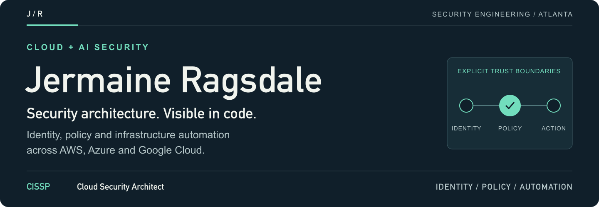
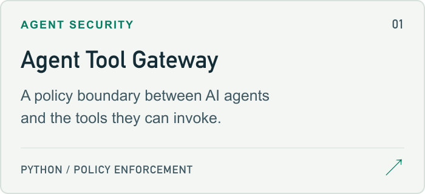
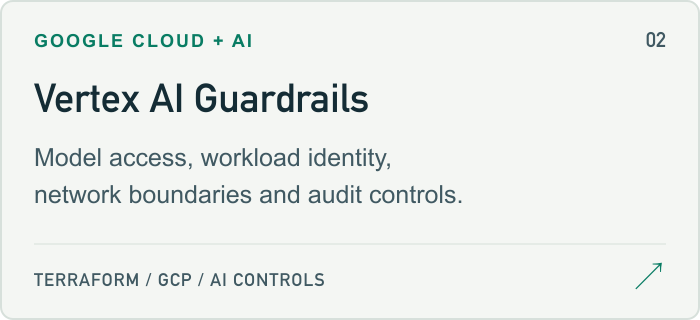
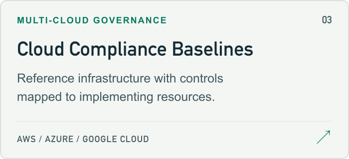
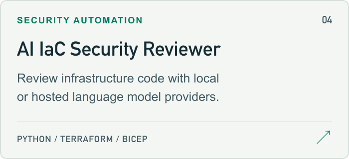
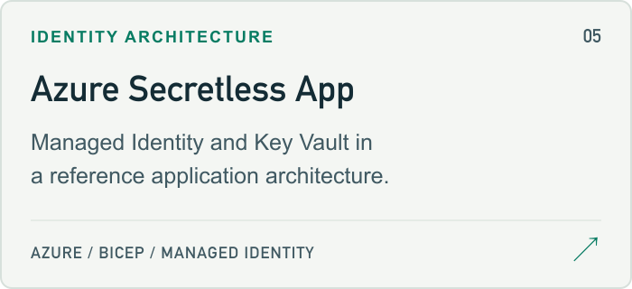
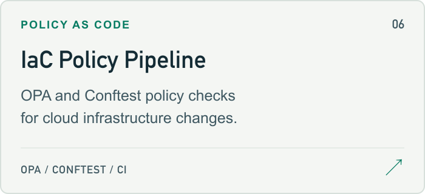

<a href="https://www.jmragsdale.com">
  <picture>
  <source media="(max-width: 600px)" srcset="assets/profile/header-mobile.png">
  
  </picture>
</a>

  <a href="https://www.jmragsdale.com"><strong>Portfolio ↗</strong></a> &nbsp; / &nbsp;
  <a href="https://www.linkedin.com/in/jermaine-ragsdale-cissp/">LinkedIn</a> &nbsp; / &nbsp;
  <a href="https://www.credly.com/users/jermaine-ragsdale/badges">Credentials</a> &nbsp; / &nbsp;
  <a href="mailto:jermaine.ragsdale@gmail.com">Email</a>

I build security controls for cloud platforms and AI systems, with a focus on identity, infrastructure automation and controls that can be inspected in code. My work spans AWS, Azure and Google Cloud, with fintech interests in auditability and data protection.

**Atlanta Metro, GA** · Open to remote opportunities and consulting.

## Selected work

Six projects across agent security, cloud architecture and policy as code. Open a card for the project, or expand the implementation links below to inspect the code and documented checks. Browse the [full security directory](#security-project-directory) for all 26 public projects.

<a href="https://github.com/jmragsdale/agent-tool-gateway">
<picture>
  <source media="(prefers-color-scheme: dark)" srcset="assets/profile/agent-gateway-dark.png">
  
</picture>
</a>
<a href="https://github.com/jmragsdale/gcp-vertex-ai-guardrails-terraform">
<picture>
  <source media="(prefers-color-scheme: dark)" srcset="assets/profile/vertex-guardrails-dark.png">
  
</picture>
</a>
<a href="https://github.com/jmragsdale/aws-compliance-baseline-terraform">
<picture>
  <source media="(prefers-color-scheme: dark)" srcset="assets/profile/compliance-dark.png">
  
</picture>
</a>
<a href="https://github.com/jmragsdale/ai-iac-security-reviewer">
<picture>
  <source media="(prefers-color-scheme: dark)" srcset="assets/profile/iac-reviewer-dark.png">
  
</picture>
</a>
<a href="https://github.com/jmragsdale/az-secretless-app">
<picture>
  <source media="(prefers-color-scheme: dark)" srcset="assets/profile/secretless-dark.png">
  
</picture>
</a>
<a href="https://github.com/jmragsdale/iac-policy-pipeline">
<picture>
  <source media="(prefers-color-scheme: dark)" srcset="assets/profile/policy-pipeline-dark.png">
  
</picture>
</a>

Implementation &amp; validation links

<ul>
<li><strong>Agent Tool Gateway</strong> — <a href="https://github.com/jmragsdale/agent-tool-gateway/blob/main/tests/test_gateway.py">Policy tests</a> · <a href="https://github.com/jmragsdale/agent-tool-gateway#sample-output">Demo</a></li>
<li><strong>Vertex AI Guardrails</strong> — <a href="https://github.com/jmragsdale/gcp-vertex-ai-guardrails-terraform/blob/main/CONTROLS.md">Control matrix</a> · <a href="https://github.com/jmragsdale/gcp-vertex-ai-guardrails-terraform/blob/main/.github/workflows/ci.yml">CI workflow</a></li>
<li><strong>Cloud Compliance Baselines</strong> — <a href="https://github.com/jmragsdale/aws-compliance-baseline-terraform/blob/main/CONTROLS.md">AWS controls</a> · <a href="https://github.com/jmragsdale/aws-compliance-baseline-terraform/blob/main/controls/controls.yaml">Definitions</a>
 <a href="https://github.com/jmragsdale/az-compliance-baseline-terraform">Azure baseline</a> · <a href="https://github.com/jmragsdale/gcp-compliance-baseline-terraform">GCP baseline</a></li>
<li><strong>AI IaC Security Reviewer</strong> — <a href="https://github.com/jmragsdale/ai-iac-security-reviewer/blob/main/reviewer.py">Implementation</a> · <a href="https://github.com/jmragsdale/ai-iac-security-reviewer/tree/main/samples">Examples</a></li>
<li><strong>Azure Secretless App</strong> — <a href="https://github.com/jmragsdale/az-secretless-app/blob/main/bicep/main.bicep">Bicep source</a> · <a href="https://github.com/jmragsdale/az-secretless-app/blob/main/secretless-architecture.svg">Architecture</a></li>
<li><strong>IaC Policy Pipeline</strong> — <a href="https://github.com/jmragsdale/iac-policy-pipeline/blob/main/policies/opa/policies_test.rego">Policy tests</a> · <a href="https://github.com/jmragsdale/iac-policy-pipeline/blob/main/.github/workflows/security.yml">CI workflow</a></li>
</ul>

These are code, tools and reference architectures. Each repository documents its own validation scope and deployment requirements.

## Working toolkit

**Platforms** &nbsp; AWS · Azure · Google Cloud 
**Infrastructure** &nbsp; Terraform · Bicep · CloudFormation 
**Security & delivery** &nbsp; OPA/Conftest · IAM · audit logging · GitHub Actions · Azure DevOps 
**Development** &nbsp; Python · Node.js · Bash · Docker

<!-- SECURITY DIRECTORY: START -->
## Security project directory

**26 public repositories**, grouped by cloud platform and project type. Each project link opens its refreshed README.

[AWS (9)](#aws) · [Azure (8)](#azure) · [Google Cloud (2)](#google-cloud) · [Cross-platform and local (7)](#cross-platform-and-local)

### AWS

Browse 9 AWS projects

#### Governance, identity and network security

- **[AWS Compliance Baseline](https://github.com/jmragsdale/aws-compliance-baseline-terraform/blob/main/README.md)** — Framework mappings tied to Terraform resources, with deployment limits documented.
- **[AWS IAM Boundaries](https://github.com/jmragsdale/aws-iam-least-privilege/blob/main/README.md)** — Scoped IAM roles, permission-boundary patterns and policy-simulation scripts.
- **[AWS Secrets Rotation](https://github.com/jmragsdale/aws-secrets-rotation-terraform/blob/main/README.md)** — Secrets Manager and Lambda rotation resources for RDS credentials.
- **[AWS Secure Web VPC](https://github.com/jmragsdale/aws-secure-web-vpc/blob/main/README.md)** — Subnet, routing and traffic-control configurations in Terraform.

#### Data protection, audit and file security

- **[AWS Financial Audit Trail](https://github.com/jmragsdale/aws-audit-trail-terraform/blob/main/README.md)** — Audit-processing handlers, infrastructure and integrity-verification examples.
- **[AWS PII Redaction](https://github.com/jmragsdale/aws-pii-redaction/blob/main/README.md)** — Document-processing reference using Comprehend and Lambda.
- **[AWS Secure File Upload](https://github.com/jmragsdale/aws-secure-file-upload/blob/main/README.md)** — S3, Lambda and ClamAV upload-processing reference and security notes.

#### Cloud AI and data tooling

- **[AWS AI Image Tagger](https://github.com/jmragsdale/aws-s3-ai-image-tagger/blob/main/README.md)** — S3-triggered image-analysis reference using Amazon Bedrock.
- **[AWS AI Data Migrator](https://github.com/jmragsdale/aws-ai-data-migrator/blob/main/README.md)** — Python migration tooling for S3 and DynamoDB, with data-protection helpers.

### Azure

Browse 8 Azure projects

#### Governance, identity and network security

- **[Azure Compliance Baseline](https://github.com/jmragsdale/az-compliance-baseline-terraform/blob/main/README.md)** — Terraform control mappings, policy definitions and documented deployment limits.
- **[Azure Resource Governance](https://github.com/jmragsdale/az-resource-lock-governance/blob/main/README.md)** — Tag-based resource-lock and Azure Policy reference.
- **[Entra Identity Controls](https://github.com/jmragsdale/az-entra-conditional-access/blob/main/README.md)** — Conditional Access and PIM configuration, with recovery-account notes.
- **[Azure Secretless App](https://github.com/jmragsdale/az-secretless-app/blob/main/README.md)** — Managed Identity and Key Vault application pattern, with Bicep source.
- **[Azure Hub-Spoke Network](https://github.com/jmragsdale/az-hub-spoke-secure/blob/main/README.md)** — Network-segmentation and firewall configuration reference.

#### Detection and event processing

- **[Azure Fraud Detection](https://github.com/jmragsdale/az-fraud-detection-terraform/blob/main/README.md)** — Event Hubs, Functions and Cosmos DB transaction-rule reference.

#### Cloud AI and data tooling

- **[Azure AI Document Summarizer](https://github.com/jmragsdale/azure-blob-ai-doc-summarizer/blob/main/README.md)** — Blob-triggered document-processing reference using Azure OpenAI.
- **[Azure AI Data Migrator](https://github.com/jmragsdale/az-ai-data-migrator/blob/main/README.md)** — Python migration tooling for Blob Storage and Cosmos DB, with data-protection helpers.

### Google Cloud

Browse 2 Google Cloud projects

#### Compliance and governance

- **[GCP Compliance Baseline](https://github.com/jmragsdale/gcp-compliance-baseline-terraform/blob/main/README.md)** — Terraform control mappings, organization configuration and deployment limits.

#### AI platform security

- **[Vertex AI Guardrails](https://github.com/jmragsdale/gcp-vertex-ai-guardrails-terraform/blob/main/README.md)** — Model access, identity, network reach, screening and audit configuration.

### Cross-platform and local

Browse 7 Cross-platform and local projects

#### Agent and LLM security

- **[Agent Tool Gateway](https://github.com/jmragsdale/agent-tool-gateway/blob/main/README.md)** — Caller-bound tool permissions, argument checks, taint handling and audit records.
- **[Prompt Injection Probe](https://github.com/jmragsdale/prompt-injection-probe/blob/main/README.md)** — Canary-based injection probes and reports for owned LLM applications.
- **[Local Security Copilot](https://github.com/jmragsdale/local-llm-security-copilot/blob/main/README.md)** — LM Studio-compatible log, CVE and configuration-analysis tasks.

#### Infrastructure review, policy and delivery automation

- **[AI IaC Security Reviewer](https://github.com/jmragsdale/ai-iac-security-reviewer/blob/main/README.md)** — Python reviewer for Terraform, Bicep and CloudFormation with local or hosted providers.
- **[IaC Policy Pipeline](https://github.com/jmragsdale/iac-policy-pipeline/blob/main/README.md)** — OPA/Conftest storage-exposure rules with paired AWS and Azure fixtures.
- **[CI/CD Security Patterns](https://github.com/jmragsdale/gh-actions-course/blob/main/README.md)** — OIDC and scanning reference notes for GitHub Actions; documentation and examples.

#### Cross-cloud platform examples

- **[Cloud IoT Pipelines](https://github.com/jmragsdale/cloud-iot-projects/blob/main/README.md)** — AWS and Azure IoT examples with handlers, simulators and Terraform.

<!-- SECURITY DIRECTORY: END -->

## Trading research

Indicators, scanners and reproducible research documentation.

**[ThinkScript library ↗](https://github.com/jmragsdale/trading-thinkscript)** 
Organized studies and scanners, usage guides and historical performance evidence.

**[TradingView Pine indicators ↗](https://github.com/jmragsdale/trading-breakout-scanner)** 
Breakout/GCR indicators and separate Python research tools.

Source availability and historical research do not establish native-platform parity or future trading performance. Setup details, research assumptions and validation limits are documented in each repository.

---

**Let's build clearer security boundaries.** 
Open to remote cloud security roles and consulting in AI security, infrastructure automation and policy as code.

[Visit my portfolio →](https://www.jmragsdale.com) · [Get in touch](mailto:jermaine.ragsdale@gmail.com)
